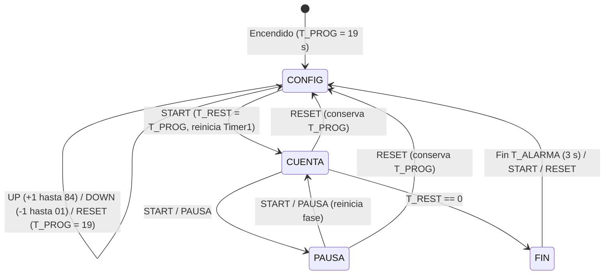

<div align="center">

# ⏱️ Programmable Countdown Timer — PIC16F877A Bare-Metal Firmware

**Firmware determinístico en lenguaje ensamblador (MPASM) para control de temporización por hardware, máquina de estados finitos, antirrebote no bloqueante y multiplexado de displays de 7 segmentos.**


-D35400?style=for-the-badge)


</div>

---

## 📌 Descripción General

Este proyecto implementa el firmware completo *bare-metal* de un temporizador regresivo programable de dos dígitos (`01` a `84` segundos) sobre el microcontrolador **Microchip PIC16F877A**.

Diseñado sin retardos bloqueantes en la base de tiempo principal, el sistema combina una **Rutina de Servicio de Interrupción (ISR)** sincronizada con el periférico **Timer1** de 16 bits y un lazo cooperativo de $10\ \text{ms}$ que gestiona simultáneamente el refresco de displays multiplexados ($\approx 100\ \text{Hz}$), el filtrado digital de rebotes en pulsadores mecánicos y las transiciones de una **Máquina de Estados Finitos (FSM)**.

<!-- Descomenta la siguiente línea cuando agregues la captura de la simulación en docs/preview.gif -->
<!--  -->

---

## 🚀 Aspectos Destacados de Ingeniería

- **Base de tiempo exacta por hardware:** generación de interrupciones periódicas cada $500\ \text{ms}$ mediante **Timer1** (preescalador `1:8`) con recarga precisa (`0x0BDC`), evitando las derivas acumulativas propias de los retardos por software.
- **Respaldo completo de contexto en la ISR:** preservación y restauración segura de `W`, `STATUS` y `PCLATH` en la memoria RAM común (`0x70–0x7F`), garantizando una ejecución libre de corrupción de registros entre bancos y páginas.
- **Multiplexado libre de *ghosting* ($\approx 100\ \text{Hz}$):** conmutación alternada de dígitos cada $5\ \text{ms}$, con apagado previo de las líneas comunes (`RC0`, `RC1`) antes de actualizar el bus de segmentos (`PORTB`).
- **Tabla de búsqueda segura (`RETLW`):** conversión BCD a 7 segmentos con cálculo dinámico de `PCLATH` y corrección de acarreo (`STATUS, C`), lo que protege el salto calculado frente al cruce de fronteras de 256 palabras en la memoria de programa.
- **Antirrebote no bloqueante por muestreo:** filtrado por ventana de estabilidad de $20\ \text{ms}$ (3 lecturas consecutivas cada $10\ \text{ms}$) con detección de flanco, asegurando una única acción por pulsación sin interrumpir el refresco visual.
- **Configuración parametrizable (`EQU`):** límites operativos definidos en tiempo de ensamblado (`T_MAX = 84 s`, `T_INI = 19 s`, `T_ALARMA = 3 s`, para la semilla `S = 64`).

---

## 🔄 Arquitectura y Máquina de Estados (FSM)

El comportamiento del sistema se gobierna mediante cuatro estados mutuamente excluyentes (`CONFIG`, `CUENTA`, `PAUSA`, `FIN`) y una bandera de fase (`F_FASE`) que alterna cada $0{,}5\ \text{s}$:



### Matriz de comportamiento por estado

| Estado | Display (7SEG-MPX2-CC) | UP / DOWN | START / PAUSA | RESET | Alarma (RC2 + RC3) |
|:------:|------------------------|-----------|---------------|-------|--------------------|
| **CONFIG** | `T_PROG` fijo | +1 (máx. 84) / −1 (mín. 01) | Inicia la cuenta (`T_REST = T_PROG`) → **CUENTA** | Restaura `T_PROG = 19` | Apagada |
| **CUENTA** | `T_REST` fijo (−1 cada 1,000 s) | Sin efecto | Pausa el conteo → **PAUSA** | Cancela y vuelve a **CONFIG** | Apagada |
| **PAUSA** | `T_REST` parpadeando a 1 Hz | Sin efecto | Reanuda el conteo → **CUENTA** | Cancela y vuelve a **CONFIG** | Apagada |
| **FIN** | `00` parpadeando a 1 Hz | Sin efecto | Silencia y vuelve a **CONFIG** | Silencia y vuelve a **CONFIG** | Pulsante (0,5 s ON / 0,5 s OFF) durante 3 s |

---

## ⏱️ Diseño de la Base de Tiempo (Timer1)

Con un cristal externo de $F_{osc} = 4\ \text{MHz}$, cada ciclo de instrucción equivale a:

$$T_{cy} = \frac{4}{F_{osc}} = 1\ \mu\text{s}$$

Utilizando el preescalador máximo de **1:8**, cada incremento del Timer1 toma $8\ \mu\text{s}$.

Dado que el Timer1 es un contador ascendente de 16 bits, su desbordamiento máximo ocurre a las $2^{16} = 65\,536$ cuentas ($0{,}524288\ \text{s}$), lo cual impide medir $1\ \text{s}$ ($125\,000$ cuentas) en un único ciclo. Para resolverlo con precisión exacta:

**Interrupción cada $0{,}5\ \text{s}$:**

$$N = \frac{0{,}5\ \text{s}}{8\ \mu\text{s}} = 62\,500\ \text{cuentas}$$

$$\text{Recarga} = 65\,536 - 62\,500 = 3\,036_{10} = \texttt{0x0BDC} \quad (\texttt{TMR1H = 0x0B},\ \texttt{TMR1L = 0xDC})$$

**Divisor de frecuencia por fase (`F_FASE`):** cada desbordamiento activa `F_MEDIO` en la ISR; el lazo principal alterna `F_FASE` cada $0{,}5\ \text{s}$ (controlando el parpadeo de 1 Hz) y decrementa `T_REST` únicamente cuando `F_FASE` regresa a 0 ($1{,}000\ \text{s}$).

---

## 🔌 Interfaz de Hardware (Pinout)

El firmware deshabilita los comparadores y las entradas analógicas por defecto (`ADCON1 = 0x06`, `CMCON = 0x07`) para operar `PORTA` en modo digital.

| Pin | Dirección | Señal / Periférico | Acondicionamiento y lógica |
|-----|:---------:|--------------------|----------------------------|
| `RA0` (pin 2) | Entrada | Pulsador **UP** | Pull-up externo 10 kΩ (activo en 0) |
| `RA1` (pin 3) | Entrada | Pulsador **DOWN** | Pull-up externo 10 kΩ (activo en 0) |
| `RA2` (pin 4) | Entrada | Pulsador **START/PAUSA** | Pull-up externo 10 kΩ (activo en 0) |
| `RA3` (pin 5) | Entrada | Pulsador **RESET** | Pull-up externo 10 kΩ (activo en 0) |
| `RB0–RB6` (pines 33–39) | Salida | Segmentos **a – g** | Cátodo común (1 = segmento encendido) |
| `RC0` (pin 15) | Salida | Común 1 (decenas) | Conexión directa en simulación (0 = dígito activo) |
| `RC1` (pin 16) | Salida | Común 2 (unidades) | Conexión directa en simulación (0 = dígito activo) |
| `RC2` (pin 17) | Salida | LED indicador de alarma | Resistencia limitadora 330 Ω (1 = encendido) |
| `RC3` (pin 18) | Salida | Zumbador (**BUZZER**) | Activo a 5 V (1 = encendido) |
| `OSC1/OSC2` (pines 13–14) | — | Oscilador principal | Cristal de 4 MHz con condensadores de 22 pF |
| `MCLR` (pin 1) | Entrada | Master Clear | Pull-up de 10 kΩ a +5 V |

---

## 📁 Estructura del Repositorio

```plaintext
├── src/
│   └── main.asm                         # Código fuente documentado en ensamblador MPASM
├── build/
│   └── firmware.hex                     # Archivo binario listo para grabar o simular
├── hardware/
│   └── temporizador_pic16f877a.pdsprj   # Esquemático y banco de pruebas en Proteus 8
├── docs/
│   └── preview.gif                      # Captura de simulación (opcional)
└── README.md
```

---

## 🛠️ Compilación y Simulación

### Requisitos

- **MPLAB X IDE v5.35** con ensamblador **MPASM v5.87** (las versiones posteriores de MPLAB X reemplazan MPASM por `pic-as`).
- **Proteus 8 Professional** (ISIS).

### Pasos de ejecución

1. **Ensamblar el firmware**
   - Abrir `src/main.asm` dentro de un proyecto *Standalone* para PIC16F877A configurado con MPASM v5.87.
   - Compilar con **Build Main Project (F11)** para generar el archivo `.hex`.

2. **Ejecutar la simulación**
   - Abrir `hardware/temporizador_pic16f877a.pdsprj` en Proteus 8.
   - Verificar en las propiedades del PIC16F877A que **Processor Clock Frequency** esté en `4MHz` y cargar el archivo `.hex`.
   - Iniciar la simulación y validar los tiempos de cuenta ($1{,}000\ \text{s}$) y de alarma ($3{,}000\ \text{s}$) mediante el cronómetro inferior de Proteus.

---

## 👥 Autores y Créditos

- **Angela Yereth Burbano** — Ingeniería Electrónica 
- **Elkin Felipe Leguizamon Martinez** — Ingeniería Electrónica 

Proyecto desarrollado en el marco de la asignatura **Electrónica Digital II** (Universidad Pedagógica y Tecnológica de Colombia — **UPTC**, 2026), bajo la orientación del **Ing. Andrés David Suárez Gómez**.
